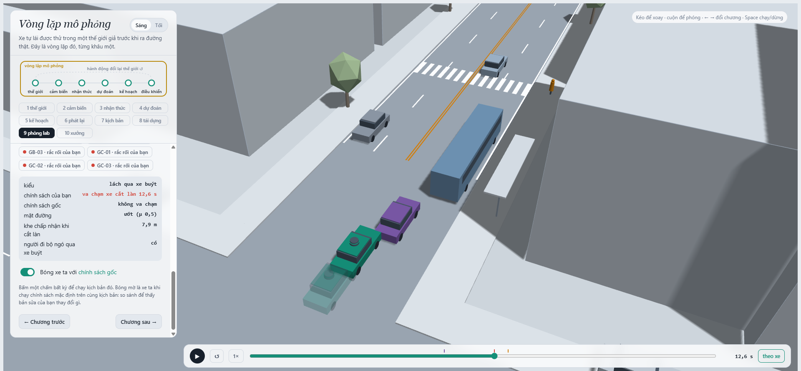
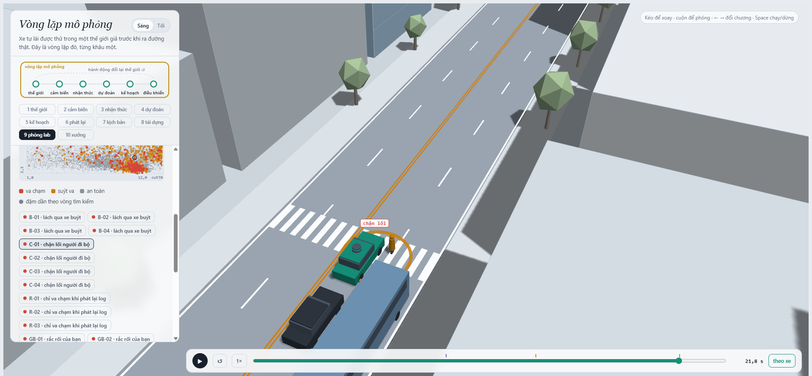
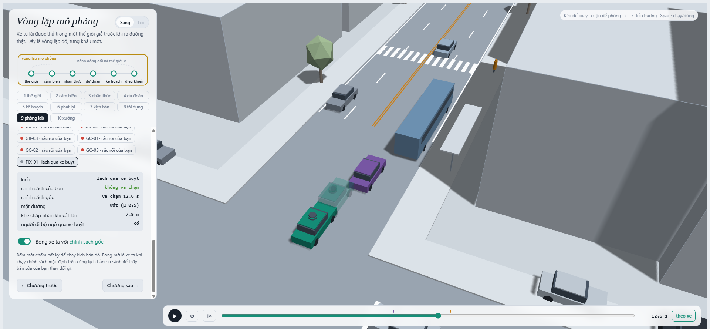

MSSV: 202602777

# Lab 11 · Scenario Forge — báo cáo

**Thị trấn:** D (meta.json: _run.town). Pipeline dùng ngân sách đầy đủ, quick=false: replay 400, MC 3.000, 8 vòng CEM × 300 mẫu, IS 3 seed × 600 mẫu mỗi kiểu, fix 400 và hazard 1.500 (meta.json: _run.budgets).

## 1. Phát lại log có trung thực không? (bước A)

| Đo | Kết quả |
|---|---:|
| Log người lái bị loại do người lái va chạm | 0/400 |
| Planner va chạm khi phát lại log | 117: rear 108, side 9 |
| Planner va chạm trong thế giới phản ứng | 1: side |
| Va chạm có ở cả hai thế giới | 0 |

108/117 va chạm phát lại là va chạm đuôi. Khi planner thay người lái, các xe khác vẫn bám quỹ đạo cũ của log nên không phản ứng với phanh hoặc vị trí mới của ego; trong thế giới phản ứng, chúng điều chỉnh theo ego. Vì vậy các va chạm chỉ có trong replay là phản thực, không phải va chạm của cùng một tương tác thật.

Ví dụ replay.json: replay_only[0]: scenario 1, contact rear, TTC trong thế giới phản ứng 2,613 s. Rerun chính xác được lưu ở evidence/replay_case_1.json: người lái không va chạm; replay có ego–TG lúc 20,45 s (fake=true); thế giới phản ứng không va chạm.

## 2. Kịch bản bất khả thi (bước B)

is_feasible loại kịch bản nếu: (1) thời gian chuyển làn không dương hoặc gia tốc ngang cực đại (π / cutDur)² × 3,5 / 2 vượt μg; (2) phanh sau khi nhập làn cutBrake > μg; (3) người đi bộ chạy nhanh hơn 2,5 m/s; (4) cutV không nằm trong (0, 22] m/s; hoặc μ < 0. Đây là các giới hạn bám đường, phanh, vận động của người đi bộ và miền tốc độ có ý nghĩa vật lý.

Cuộc săn crosswalk_block có nhiều mẫu bất khả thi nhất: 16/2.400 (hunt.json). Proposal cuối dịch xác suất nhị phân từ town D [wet=.15, pedLook=.90, brakes=.20] sang [.916, .030, .033]; nó ưu tiên người đi bộ không ngó qua xe buýt và đường ướt, nơi giới hạn bám đường chặt hơn. Các đuôi proposal tạo thêm mẫu không khả thi; chúng phải bị loại, không tính là lỗi.

MC có 12 mẫu không khả thi. Nếu tính nhầm chúng là va chạm thì kết quả thành (4+12)/3000 = 0,00533, gấp bốn p̂ hợp lệ 0,00133 (mc.json).

## 3. Monte Carlo cho bạn biết gì (bước C1)

mc.json: k=4, n=3000, p=0,001333; Wilson 95% [0,000519; 0,003424]. Nếu p thật tiếp tục bằng p̂ này, cần khoảng **72.638 lượt** để nửa độ rộng Wilson còn ≤20% p̂.

Không thấy cut_in, crosswalk_block, rear_ended hoặc other trong MC. Không được báo xác suất bằng 0: với từng kiểu 0/3.000, cận trên Wilson 95% là 0,001279 (mc.json: per_mode.*.hi).

## 4. Importance sampling, ESS và độ suy biến (bước C3)

Mỗi ô ghi p / hits / ESS / top_share (estimate.json).

| Kiểu | Seed 0 | Seed 1 | Seed 2 |
|---|---|---|---|
| bus_bypass | 6,36e-4 / 47 / 139 / .584 | 1,04e-3 / 52 / 124 / .357 | 2,58e-4 / 49 / 123 / .175 |
| cut_in | 0 / 0 / 109 / 0 | 0 / 0 / 125 / 0 | 0 / 0 / 127 / 0 |
| crosswalk_block | 9,04e-7 / 85 / 116 / .775 | 8,89e-7 / 86 / 116 / .648 | 1,31e-7 / 92 / 115 / .277 |
| rear_ended | 0 / 0 / 123 / 0 | 0 / 0 / 110 / 0 | 0 / 0 / 120 / 0 |

Tổng ba seed lần lượt là 6,37e-4 [0; 2,67e-3], 1,04e-3 [8,94e-5; 3,27e-3], và 2,58e-4 [1,11e-4; 1,68e-3]. Khoảng tin cậy giao nhau và đều tương thích với MC, nhưng p̂ lệch khoảng 4 lần giữa các seed nên độ chính xác còn yếu. top_share > .5 ở bus_bypass seed 0 và crosswalk_block seed 0–1: khi đó hơn nửa ước lượng đến từ trọng số của một mẫu, không phải hàng trăm quan sát hiệu dụng. ESS chỉ khoảng 109–139 trên 600 mẫu.

budget=16.800 lượt mô phỏng. MC cần khoảng 72.638 lượt cho mục tiêu ±20%, nhưng không thể nói IS đạt độ chính xác đó với ngân sách thấp hơn: ESS thấp và top_share cao cho thấy phương sai trọng số lớn. other lấy từ 0/3.000 của MC, cận trên 0,001279; không săn nó vì đây là phần dư chưa có một kiểu sự kiện nhất quán để CEM nhắm tới.

## 5. Các kiểu thất bại (bước C2 + 3D)

Hai kiểu tìm được là bus_bypass và crosswalk_block. hunt.json: found: săn bus tìm 145 bus_bypass; săn crosswalk tìm 68 crosswalk_block và 2 bus_bypass. Săn cut_in chỉ tìm 23 bus_bypass; săn rear_ended tìm 2 bus_bypass và 2 crosswalk_block, không tìm được chính kiểu nó nhắm tới. Vì thế mức tin vào việc chưa tìm thấy cut_in và rear_ended thấp: ngân sách và proposal có thể bỏ lỡ chúng. Một cuộc săn chung dễ tập trung vào basin bus_bypass dễ tìm hơn và che khuất kiểu khác.

B-01: C2 len qua xe buýt đang dừng rồi chạm ego ở 12,6 s; ghost của policy sửa tránh được. C-01: người đi bộ khuất sau xe buýt, ego dừng trên vạch qua đường và chặn người đó ở 21,75 s.

## 6. Sửa planner (bước E + 3D)

Policy được chọn trên TRAIN là cutinLat=3.0 (fix.json: chosen.policy).

| Tập / policy | fail | fail_hi | fail_hi_seen | Quãng đường | Khung hình phanh gấp |
|---|---:|---:|---:|---:|---:|
| TRAIN, gốc | 2,01e-4 | 3,44e-4 | 3,44e-4 | 213,946 m | 7,961 |
| TRAIN, sửa | 2,45e-8 | 3,44e-8 | 3,44e-8 | 213,934 m | 7,703 |
| TEST, gốc | 3,55e-4 | 1,99e-3 | 7,14e-4 | 217,823 m | 7,951 |
| TEST, sửa | 3,25e-7 | 3,88e-2 | 6,56e-7 | 217,807 m | 7,473 |

Quãng đường gần như giữ nguyên. fail_hi TEST của policy sửa lớn hơn fail của policy gốc vì proposal TEST không thấy bus_bypass (unseen=['bus_bypass']); cận 0-hit 3/ESS riêng cho kiểu này là 0,0375, cộng với cận cho other từ MC. fail_hi_seen chỉ mô tả kiểu đã thấy, không phải cận trên hợp lệ cho toàn bộ policy.

Một núm “nghe an toàn hơn” nhưng làm TRAIN xấu hơn là cautionV=6.5: p̂ 3,33e-4, so với baseline 2,01e-4; progress giảm còn 198,4 m và khung hình phanh gấp tăng lên 8,824 (fix.json: table). Phần tăng ở đây là bus_bypass. Cách giải thích phù hợp với mô hình phản ứng là giảm tốc độ ego đổi thời điểm tương đối khi C2 len qua xe buýt; đây là suy luận từ phân loại và kết quả mô phỏng, không phải bằng chứng nhân quả ngoài đời.

FIX-01 chạy policy sửa trên chính tham số B-01: policy sửa không va chạm, bóng mờ policy gốc va chạm C2 ở 12,6 s.

## 7. Từ mô phỏng ra đường thật

Ba giả định nổi bật của town D (space.py):

1. **Khe nhập làn:** median cutGap=14 m. Thay bằng quỹ đạo nhập làn và khoảng trống chấp nhận đo từ SHRP2 NDS kết hợp video giao thông địa phương. Nếu khe thật thường nhỏ hơn 14 m, mô phỏng có thể đánh giá thấp các lần nhập làn sát; nếu lớn hơn, có thể đánh giá cao rủi ro. [SHRP2 Naturalistic Driving Study](https://www.fhwa.dot.gov/goshrp2/Solutions/Safety/NDS/Naturalistic_Driving_Study).
2. **Người đi bộ ngó qua xe buýt:** xác suất pedLook=.90. Đếm trên video tại các điểm dừng xe buýt địa phương, ghi riêng việc nhìn quanh xe trước khi bước xuống. Tỷ lệ nhìn thấp hơn .90 làm occlusion phổ biến hơn, nên mô phỏng hiện tại có thể đánh giá thấp rủi ro.
3. **Đường ướt:** xác suất wet=.15, ma sát μ=.5 khi ướt. Dùng nhật ký mưa địa phương cùng phép đo ma sát mặt đường bằng xe đo/instrumented vehicle. Nếu đường ướt thường xuyên hơn hoặc μ thấp hơn, mô phỏng sẽ quá lạc quan về phanh và bám đường.

## 8. Giới hạn

- Chỉ một con phố tổng hợp và một cửa sổ 24 giây; không đại diện mọi tuyến, tốc độ hay mùa.
- Hành vi người tham gia dựa trên các quy tắc phản ứng/IDM và vài biến rời rạc; không bao trùm đa dạng người lái, người đi bộ và người đi xe đạp.
- Che khuất được mô hình hóa đơn giản; không có sai số cảm biến và ý định đầy đủ như trên xe thật. Phơi nhiễm xe đạp là prior từ một mẫu nhỏ, không phải tần suất địa phương.

Nếu có thêm một tuần, tôi sẽ đo video/quỹ đạo tự nhiên tại điểm dừng xe buýt và vạch qua đường, thu thập các lần xe đạp né chướng ngại, cùng tốc độ/ma sát đường khô và ướt; sau đó hiệu chỉnh phân phối và giữ một tập tuyến riêng để kiểm tra ngoài mẫu.

## 9. Rắc rối của bạn (bước G + chương 10)

- **Rắc rối:** xe đạp H0 từ làn E2 lạng 3,8 m vào làn ego trong 2,6 s; ở cảnh gốc, nó xuất phát tại x=-20 m, v=3 m/s, bắt đầu ngay khi ego còn cách 20 m. Đây là tình huống xe đạp tránh chướng ngại rồi lấn vào làn.
- **Căn cứ:** planner chạm H0 ở 2,15 s (mine.json: exact.planner). Planner hiện chưa dự đoán tốt ý định lấn ngang của xe đạp.
- **Giả định:** hazard.json cho h0_x=[-20,10], d=[.5,1], v=[3,5], swerve=[3.2,3.8], swDur=[2.6,3.2], t0=[0,1], trig=[15,35]. Exposure 0,00031/cửa sổ 24 s được ngoại suy từ 6 near-collision trong 127 giờ 38 phút của 13 người đi xe đạp; đây là prior nhỏ, không địa phương và bao gồm nhiều loại xung đột. [Nghiên cứu naturalistic cycling](https://pmc.ncbi.nlm.nih.gov/articles/PMC3242541/). FHWA ghi nhận người đi xe đạp thường cách lề 0,8–1,0 m và bề rộng quét xe đạp ở percentile 95 là 1,4 m; swerve trong hazard là tình huống bất thường, không phải dao động thường ngày. [Vị trí người đi xe đạp trên đường](https://www.fhwa.dot.gov/publications/research/safety/04091/02.cfm), [bề rộng vận hành xe đạp](https://www.fhwa.dot.gov/publications/research/safety/04103/06.cfm).
- **Kết quả:** 1.492/1.500 mẫu khả thi, accepted=99,47% (mine.json). Có điều kiện theo hazard, baseline có 465 va chạm: 462 avoidable, 2 unavoidable, 1 unattributed; 1 low_speed; p=0,3097, Wilson [0,2867; 0,3336]. Policy sửa có 193: 190 avoidable, 3 unavoidable, 0 unattributed; 3 low_speed; p=0,1273, Wilson [0,1114; 0,1452]. Per-trip theo exposure: baseline 9,60e-5 (upper 1,03e-4), policy sửa 3,95e-5 (upper 4,50e-5). Đặt cạnh bus_bypass MC 4/3000=0,00133/lượt (mc.json); các con số hazard này vẫn phụ thuộc prior phơi nhiễm xe đạp.
- **Hình:** ảnh chương 10 tại va chạm 2,15 s.
- **Bạn tự lái thì sao:** chưa thử chế độ người lái; hazard.json lưu ego=planner, không có bản ghi điều khiển tay.
- **Cách sửa:** cần theo dõi xe đạp cạnh xe, ước lượng vận tốc/ý định ngang, dự đoán vùng chiếm làn trong vài giây tới và phanh trước khi quỹ đạo cắt nhau. Chỉ tăng cutinLat xử lý xe cắt làn ô tô, không thay thế logic dự đoán xe đạp.
